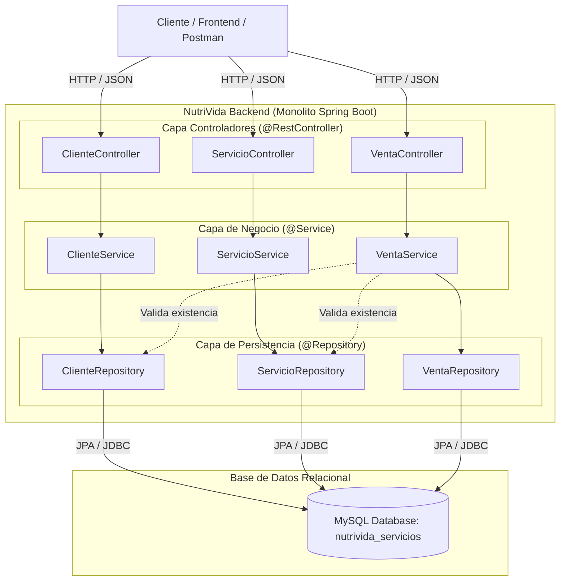

# 🥗 NutriVida Backend - API REST

API REST para la gestión integral de clientes, servicios nutricionales y ventas de **NutriVida**. Desarrollada con **Spring Boot** y **MySQL** bajo una arquitectura en capas tipo **Monolito Modular**.

---

## 📋 Tabla de Contenidos

1. [Descripción General](#-descripción-general)
2. [Arquitectura del Sistema](#-arquitectura-del-sistema)
3. [Stack Tecnológico](#-stack-tecnológico)
4. [Estructura del Proyecto](#-estructura-del-proyecto)
5. [Modelos de Datos](#-modelos-de-datos)
6. [Instalación y Configuración](#-instalación-y-configuración)
7. [Documentación de la API REST](#-documentación-de-la-api-rest)
   - [Módulo Clientes](#1-módulo-clientes-apiclientes)
   - [Módulo Servicios](#2-módulo-servicios-apiservicios)
   - [Módulo Ventas](#3-módulo-ventas-apiventas)
8. [Reglas de Negocio Implementadas](#-reglas-de-negocio-implementadas)

---

## 📖 Descripción General

Este backend provee servicios RESTful para administrar las operaciones esenciales de NutriVida:
* **Gestión de Clientes:** Registro, actualización y consulta de clientes con datos demográficos y de contacto.
* **Catálogo de Servicios:** Administración de consultas y planes nutricionales (precios, descripciones, estado activo).
* **Registro de Ventas:** Contratación de servicios con cálculo automatizado del total según la cantidad y el precio del servicio.

---

## 🏛 Arquitectura del Sistema

El proyecto está diseñado bajo el patrón **Arquitectura en Capas (Layered Architecture)** y califica como un **Monolito Modular**:



### ¿Por qué califica como Monolito?
1. **Un solo artefacto de despliegue:** Toda la aplicación compila y empaqueta en un único `.jar`.
2. **Base de datos compartida:** Las tres tablas (`cliente`, `servicio`, `venta`) conviven en el mismo esquema MySQL (`nutrivida_servicios`).
3. **Ejecución en un solo proceso:** Los módulos corren en el mismo proceso de memoria y exponen sus rutas en un único puerto (`8082`).
4. **Desacoplamiento de entidades por ID:** Para simplificar el alcance y facilitar una futura migración hacia microservicios, las entidades no usan relaciones JPA directas (`@ManyToOne` o `@OneToMany`). En su lugar, `Venta` almacena llaves foráneas escalares (`clienteId`, `servicioId`), validándolas a nivel de servicio.

---

## 🛠 Stack Tecnológico

* **Lenguaje:** Java 25
* **Framework:** Spring Boot 4.1.2
* **ORM / Persistencia:** Spring Data JPA / Hibernate
* **Motor de Base de Datos:** MySQL / MariaDB (versión 10.4+ / MySQL 8.0+)
* **Gestor de Dependencias:** Apache Maven
* **Librerías de Utilidad:** Lombok (Getters, Setters, Inyección por constructor)
* **Validación:** Jakarta Validation / Spring Validation

---

## 📂 Estructura del Proyecto

```text
NutriVida-Backend-master/
├── pom.xml                                     # Configuración de dependencias Maven
├── mvnw / mvnw.cmd                             # Wrapper de Maven
├── src/
│   ├── main/
│   │   ├── java/com/nutrivida/servicioservice/
│   │   │   ├── ServicioServiceApplication.java # Clase principal de arranque Spring Boot
│   │   │   ├── controller/                     # Controladores REST (@RestController)
│   │   │   │   ├── ClienteController.java
│   │   │   │   ├── ServicioController.java
│   │   │   │   └── VentaController.java
│   │   │   ├── model/                          # Entidades JPA (@Entity)
│   │   │   │   ├── Cliente.java
│   │   │   │   ├── Servicio.java
│   │   │   │   └── Venta.java
│   │   │   ├── repository/                     # Repositorios Spring Data JPA
│   │   │   │   ├── ClienteRepository.java
│   │   │   │   ├── ServicioRepository.java
│   │   │   │   └── VentaRepository.java
│   │   │   └── service/                        # Lógica de negocio (@Service)
│   │   │       ├── ClienteService.java
│   │   │       ├── ServicioService.java
│   │   │       └── VentaService.java
│   │   └── resources/
│   │       ├── application.properties          # Configuración de puerto, datasource y JPA
│   │       └── sql/
│   │           └── nutrivida_servicios.sql     # Script de creación y carga inicial de MySQL
│   └── test/                                   # Pruebas unitarias y de contexto
```

---

## 🗄 Modelos de Datos

### 1. `Cliente` (Tabla: `cliente`)
| Atributo | Tipo de Dato | Restricciones | Descripción |
| :--- | :--- | :--- | :--- |
| `id` | `Long` | Primary Key, Auto Increment | Identificador único |
| `run` | `String (12)` | Not Null, Unique | RUT / RUN del cliente |
| `pnombre` | `String (50)` | Not Null | Primer nombre |
| `snombre` | `String (50)` | Nullable | Segundo nombre |
| `apaterno` | `String (50)` | Not Null | Apellido paterno |
| `amaterno` | `String (50)` | Nullable | Apellido materno |
| `correo` | `String (100)` | Not Null, Unique | Correo electrónico |
| `fechaNacimiento` | `LocalDate` | Nullable | Fecha de nacimiento (`YYYY-MM-DD`) |
| `direccion` | `String (300)` | Nullable | Dirección física |

### 2. `Servicio` (Tabla: `servicio`)
| Atributo | Tipo de Dato | Restricciones | Descripción |
| :--- | :--- | :--- | :--- |
| `id` | `Long` | Primary Key, Auto Increment | Identificador único |
| `nombre` | `String (150)` | Not Null, Unique | Nombre del servicio o plan |
| `descripcion` | `String (Text)` | Nullable | Detalle del servicio |
| `precio` | `BigDecimal` | Not Null, Precision 10,2 | Precio unitario (> 0) |
| `imagenUrl` | `String (255)` | Nullable | Nombre o URL de imagen referencial |
| `activo` | `Boolean` | Not Null, Default `true` | Estado del servicio |

### 3. `Venta` (Tabla: `venta`)
| Atributo | Tipo de Dato | Restricciones | Descripción |
| :--- | :--- | :--- | :--- |
| `id` | `Long` | Primary Key, Auto Increment | Identificador único |
| `clienteId` | `Long` | Not Null | ID del cliente asociado |
| `servicioId` | `Long` | Not Null | ID del servicio contratado |
| `cantidad` | `Integer` | Not Null, Default 1 | Cantidad contratada (> 0) |
| `total` | `BigDecimal` | Not Null, Precision 10,2 | Monto total calculado automáticamente |
| `fechaVenta` | `LocalDateTime` | Not Null | Fecha y hora generada automáticamente |

---

## 🚀 Instalación y Configuración

### 1. Prerrequisitos
* **Java Development Kit (JDK):** Versión 17 o superior (configurado para compilación en Java 25).
* **MySQL Server o XAMPP / MariaDB:** Corriendo en el puerto local por defecto (`3306`).
* **Maven:** (Opcional si se utiliza el wrapper incluido `mvnw`).

### 2. Base de Datos
1. Iniciar el servicio de MySQL (por ejemplo, desde el panel de XAMPP).
2. Crear la base de datos o importar directamente el archivo ubicado en:
   ```text
   src/main/resources/sql/nutrivida_servicios.sql
   ```
   * En phpMyAdmin: Crear la base de datos `nutrivida_servicios` e importar el archivo.
   * O por terminal MySQL:
     ```bash
     mysql -u root -p -e "CREATE DATABASE nutrivida_servicios;"
     mysql -u root -p nutrivida_servicios < src/main/resources/sql/nutrivida_servicios.sql
     ```

### 3. Configuración de Credenciales
Revisar o editar el archivo [src/main/resources/application.properties](file:///c:/Users/juanm/OneDrive/Desktop/kotlin/NutriVida-Backend-master/src/main/resources/application.properties):

```properties
spring.application.name=servicio-service
server.port=8082

# Conexión MySQL
spring.datasource.url=jdbc:mysql://localhost:3306/nutrivida_servicios?useSSL=false&serverTimezone=UTC
spring.datasource.username=root
spring.datasource.password=

# Configuración Hibernate
spring.jpa.hibernate.ddl-auto=validate
spring.jpa.show-sql=true
```

### 4. Compilar y Ejecutar

Desde la raíz del proyecto:

* **En Windows (PowerShell / CMD):**
  ```powershell
  .\mvnw.cmd spring-boot:run
  ```
* **En Linux / macOS:**
  ```bash
  ./mvnw spring-boot:run
  ```

La aplicación quedará disponible en: `http://localhost:8082`

---

## 📡 Documentación de la API REST

### 1. Módulo Clientes (`/api/clientes`)

| Método | Endpoint | Descripción | Código Éxito |
| :--- | :--- | :--- | :--- |
| `GET` | `/api/clientes` | Lista todos los clientes | `200 OK` |
| `GET` | `/api/clientes/{id}` | Obtiene un cliente por su ID | `200 OK` (o `404`) |
| `POST` | `/api/clientes` | Registra un nuevo cliente | `201 Created` |
| `PUT` | `/api/clientes/{id}` | Actualiza un cliente existente | `200 OK` |
| `DELETE` | `/api/clientes/{id}` | Elimina un cliente por su ID | `204 No Content` |

#### Ejemplo de Petición - Crear Cliente (`POST /api/clientes`):
```json
{
  "run": "12345678-9",
  "pnombre": "Constanza",
  "snombre": "Belen",
  "apaterno": "Vergara",
  "amaterno": "Castro",
  "correo": "constanza.vergara@example.com",
  "fechaNacimiento": "1998-07-20",
  "direccion": "Av. Las Encinas 1230, Temuco"
}
```

---

### 2. Módulo Servicios (`/api/servicios`)

| Método | Endpoint | Descripción | Código Éxito |
| :--- | :--- | :--- | :--- |
| `GET` | `/api/servicios` | Lista todos los servicios | `200 OK` |
| `GET` | `/api/servicios/{id}` | Obtiene un servicio por su ID | `200 OK` (o `404`) |
| `POST` | `/api/servicios` | Registra un nuevo servicio | `201 Created` |
| `PUT` | `/api/servicios/{id}` | Actualiza datos de un servicio | `200 OK` |
| `DELETE` | `/api/servicios/{id}` | Elimina un servicio | `204 No Content` |

#### Ejemplo de Petición - Crear Servicio (`POST /api/servicios`):
```json
{
  "nombre": "Plan Nutrición Bariátrica",
  "descripcion": "Acompañamiento pre y post operatorio integral.",
  "precio": 38000.00,
  "imagenUrl": "bariatrica.jpg",
  "activo": true
}
```

---

### 3. Módulo Ventas (`/api/ventas`)

| Método | Endpoint | Descripción | Código Éxito |
| :--- | :--- | :--- | :--- |
| `GET` | `/api/ventas` | Lista todas las ventas | `200 OK` |
| `GET` | `/api/ventas/{id}` | Obtiene una venta por su ID | `200 OK` (o `404`) |
| `POST` | `/api/ventas` | Registra una nueva venta | `201 Created` |
| `PUT` | `/api/ventas/{id}` | Actualiza una venta | `200 OK` |
| `DELETE` | `/api/ventas/{id}` | Elimina una venta | `204 No Content` |

#### Ejemplo de Petición - Registrar Venta (`POST /api/ventas`):
> *Nota: No es necesario enviar el atributo `total` ni `fechaVenta`; el sistema valida la existencia del cliente y servicio, toma el precio actual del servicio y calcula automáticamente el total.*
```json
{
  "clienteId": 1,
  "servicioId": 2,
  "cantidad": 2
}
```

#### Respuesta Ejemplo (`201 Created`):
```json
{
  "id": 2,
  "clienteId": 1,
  "servicioId": 2,
  "cantidad": 2,
  "total": 40000.00,
  "fechaVenta": "2026-11-11T22:30:15.123456"
}
```

---

## 🛡 Reglas de Negocio Implementadas

1. **Validación de Datos en Clientes:**
   * `run`, `pnombre`, `apaterno` y `correo` son obligatorios y no pueden estar vacíos (`400 Bad Request`).
   * Los campos `run` y `correo` son únicos a nivel de base de datos.
2. **Validación de Servicios:**
   * El `nombre` es obligatorio y único.
   * El `precio` es obligatorio y debe ser estrictamente mayor a cero.
   * Si no se especifica el campo `activo`, por defecto se asigna en `true`.
3. **Cálculo y Validación de Ventas:**
   * `clienteId`, `servicioId` y `cantidad` (> 0) son obligatorios.
   * Se verifica la existencia del cliente; si no existe, devuelve `404 Not Found` (*"Cliente no encontrado"*).
   * Se verifica la existencia del servicio; si no existe, devuelve `404 Not Found` (*"Servicio no encontrado"*).
   * El `total` se computa automáticamente como `precio_servicio * cantidad`.
   * La fecha y hora de la venta se asigna en el momento exacto del guardado mediante el callback `@PrePersist`.
